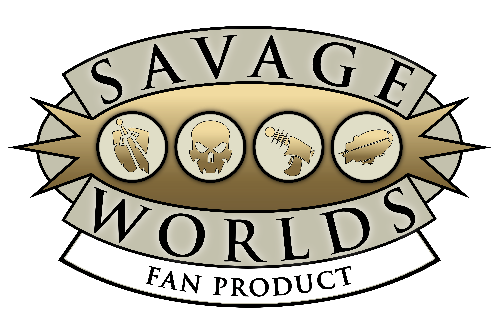

# Savage Worlds Compatibility Package for Gravewright



[Português](README.pt-BR.md)

Release **`gravewright.savage-worlds` 0.1.0** of this Django-compatible implementation,
reviewed against the revised 2026 Brazilian SWADE edition. The horizontal header, five tabs and VTT
palette remain. System models, UI and numerical rules live in this project;
the host supplies only generic document, dice, card, combat and modal contracts.

Collections and descriptions start empty. No reference PDF, rulebook descriptions,
setting, characters, catalogs or compendiums are distributed. The only official
image included is the unchanged logo supplied for use with permission.
Users author content and configure its mechanical effects.

This package remains free and provides technical compatibility. Pinnacle's names,
trademarks and logo are excluded from the MIT license for the original code.

This game references the Savage Worlds game system, available from Pinnacle Entertainment Group at www.peginc.com. Savage Worlds and all associated logos and trademarks are copyrights of Pinnacle Entertainment Group. Used with permission. Pinnacle makes no representation or warranty as to the quality, viability, or suitability for purpose of this product.

## Installation

Requires [Gravewright **0.2.3 or later**](https://github.com/Gravewright/gravewright/releases/tag/v0.2.3),
SDK **1.0.0** and its translation API. Version 0.2.3 includes the generic
`context.host` and `card.asset.upload` contracts used by deck imports.

Download both ZIPs from the [0.1.0 release](https://github.com/Gravewright/Savage-Worlds-Compatibility-Package-for-Gravewright/releases/tag/v0.1.0),
or install them through the signed Gravewright Marketplace.

1. Install `dist/gravewright-savage-worlds-rules-0.1.0.zip` under **Modules** as
   a Django extension and activate it through the native installer. The managed
   Runner restarts the host.
2. Install `dist/gravewright-savage-worlds-0.1.0.zip` under **Systems**, then
   select **Savage Worlds Compatibility Package for Gravewright** for the table. Existing tables must explicitly
   select the new package version.

Both the browser system and server rules extension use **0.1.0** for this release.
Versions 0.2.x–0.4.0 were internal development numbers. Explicitly select **0.1.0**
in development tables, which may still select a numerically higher prototype.
Package IDs, actor data and table settings remain unchanged.
This numbering belongs to the new implementation and does not rename releases
of the previously published compatibility package.

Update older Gravewright 0.2.2 installations to 0.2.3 before importing decks.

Builds do not activate production packages or edit `.env`. Without the server
extension, sheets and rolls remain usable, but combat advancement explicitly
requires the matching provider.

## Languages through the official Translator

Install and activate [Translator](https://github.com/Gravewright/translator)
in Installed modules. In a table, open **Settings → Preferences → Interface
language** and choose **English**, **Português (Brasil)** or **Español**.
The native flow saves each participant's account preference and reloads the
same table. Integration is verified with Translator 0.1.2.

SWADE registers 646 labels per language using `context.i18n.register`, then uses
`api.i18n.t` and `api.i18n.onChange`. Private system catalogs stay isolated from
the host and other modules. Without an active language package the host uses
English. Owned UI has `translate="no"` to avoid a second legacy translation.

Sheets, items, combat, modals and Customize translate labels, hints and feedback.
Adapter-driven language updates keep existing controls, drafts, focus, selection
and pending actions. Authored names, descriptions and data retain their original
text. The public product name, Fan Product logo and exact Pinnacle notice retain
their permitted presentation. Deck preview images contain no baked interface
titles; Translator renders their names and counters in the surrounding UI.

## System features

**Extensions → Savage Worlds → Customize** opens package-owned sections:

- **Action decks**: Ivory Classic, Gravewright Dark and Adventure Engraving.
  Each includes 52 original card fronts, two Jokers and a matching back.
  **Create and use** imports actual images and creates a native table deck.
  Import progress is persistent; repeating a choice reuses the created deck.
- **Table settings**: currency name and visibility, Power Points, wound cap,
  Joker Benny awards, wound Pace reduction and encumbrance penalties. **Save**
  shares these options with the table.
- **About**: the permitted Fan Product logo, free compatibility scope and the
  exact English permission notice supplied by Pinnacle.

Players can inspect options and browse card artwork. Only GMs change settings
or create decks. Sheets inherit table rules, with explicit character overrides.
Hiding currency or disabling PP preserves existing balances and pools. Conflicts
preserve the local draft. All SWADE configuration belongs to this package.

Characters and NPCs can represent Wild Cards or Extras. Settings cover encounter
role, Wild Die, Size, wound capacity, running, load units and manual exceptions.
Fresh sheets calculate Parry, Toughness, armor, Pace, load and Rank. Explicit
overrides take precedence; older sheets preserve entered totals and stay manual
until calculation is enabled. Armor layers, protected areas and shields are
separate; quantities, units and the Carried flag affect load.

Features group Edges, Hindrances, ancestries, racial features and user-authored
effects. Numeric modifiers never identify abilities by item name. Powers have
separate Arcane Background pools and skills, activation costs, shorting,
maintenance, duration and resting. The advancement ledger checks Rank boundaries,
available advances and attribute frequency without a rulebook list.

Arcane devices bind owned powers and have their own pool. Investing and reclaiming
PP obeys the per-action limit and preserves allocation: personal recharging cannot
recreate points still invested in a device.

Thirteen templates: `weapon`, `armor`, `equipment`, `consumable`, `skill`, `edge`,
`hindrance`, `ancestry`, `racial-feature`, `power`, `effect`, `vehicle`,
`arcane-device`. Native library documents and independent owned copies follow
host permissions.

## Rolls and combat

The native dice engine publishes rolls. The package interprets Aces, Wild Dice,
untrained and opposed rolls, successes, raises, Critical Failures and Benny
rerolls. Wounds, Fatigue, conditions, load and multi-actions contribute penalties
according to context. Attack dialogs provide situational controls; damage never
adds a Wild Die.

Incoming damage previews Toughness and armor, offers Soak before applying wounds,
and respects Extras, Wild Cards and configurable capacity. Recovery, natural
healing, stabilization, Support and Tests use explicit results. Injury and power
details and narrative choices are user-authored; no content tables are bundled.

The tracker requires a deck created and selected through the native card system.
**Customize → Action decks** creates one of the three styles and selects the
table default. An encounter keeps its deck until combat ends. Explicit choices
in **Combat → Configure deck** override the table default. GMs can also supply
their own card names and images in **Your hand → Decks → Create deck**.
For standard Action Cards, configure 52 playing cards and two Jokers; use names
such as `A ♠`, `K ♥`, `★ 1` and `★ 2`. Deck creation requires an explicit choice
in Customize. Changing an encounter's selected deck requires stopping combat.
Card previews use only the native faces available to the current viewer.
When migrating from the internal 0.3.1 prototype, explicitly select a native deck; an older automatically
created deck ID is not adopted as configuration. Every drawn Action Card needs
its own native front image.

The tracker interprets rank/suit ordering, groups, holding, extra Benny draws
and Joker bonuses from that deck. The GM deals cards and confirms **Begin round**
after extra draws. Native combat owns turns and permissions. In the **Combat**
panel, the GM adds participants and chooses **Start combat**; starting requires
at least one participant and an available selected deck. **Pause** preserves the cards,
round and current turn; **Resume** continues from that saved position.
The paused state persists across reopening the panel. **Stop combat** concludes
the encounter. The panel shows whether combat is stopped, in progress or paused.
The GM can adjust the shared Benny pool and grant one to an NPC/Extra without one.
The server provider advances configured clocks, including skipped turns, without
automatically rolling actions or damage. Moving backward does not undo outcomes
or resources already resolved.

## Modals and data

Auxiliary windows use `api.ui.openModal` with `section` elements, without HTML
`dialog` tags or browser alerts. Native contracts handle focus, Escape, text
selection, nested windows and closing. Close waits for work; retries retain the
same creation, copy, published roll or application.

Autosave uses native versions. Conflicts preserve drafts until explicit review.
Host permissions remain authoritative, including the GM requirement for generated
Support effects. Linked tokens share actors; independent tokens keep their own
snapshots. Data is stored directly in sheet `data` with `schemaVersion: 2`.
Data from earlier prototypes and unknown fields are preserved. Server code lives under
`server/gravewright_swade`, without new host models, tables, routes or dependencies.

## Validation and build

```sh
npm test
python -m unittest discover -s tests -p "test_package.py"
python tests/test_item_editor_browser.py
python tests/test_modal_browser.py
python tests/test_actions_browser.py
python tests/test_customization_browser.py
python tests/e2e/languages.py
python server/tests/run_django_tests.py
python scripts/build_server.py
python scripts/build.py
python scripts/validate_package.py
```

Suites in `tests/e2e` install actual ZIPs into disposable databases, media and
tables without changing `.env` or live data. Browser ZIPs exclude Python server
source, tools, tests and private references. Both ZIPs have SHA-256 sidecars.
Original code uses [MIT](LICENSE.md); see [NOTICE.md](NOTICE.md).
